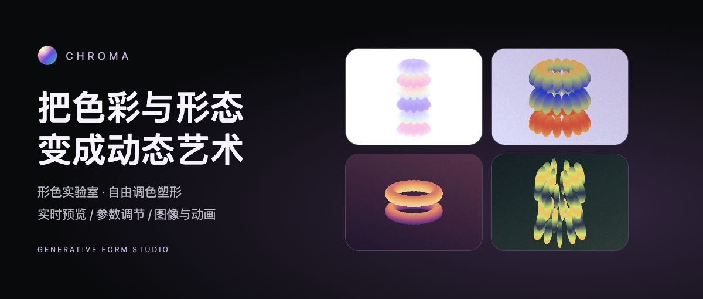
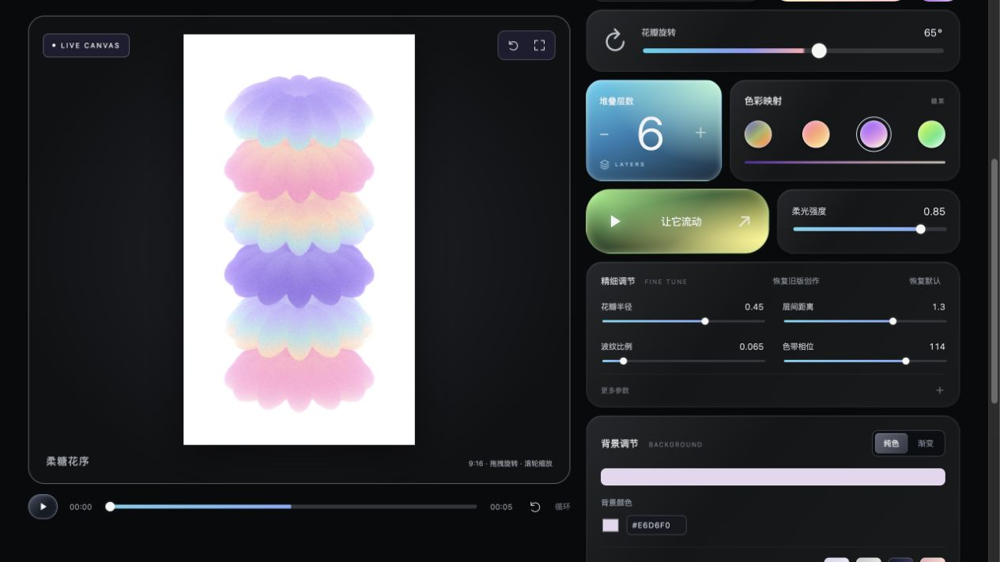
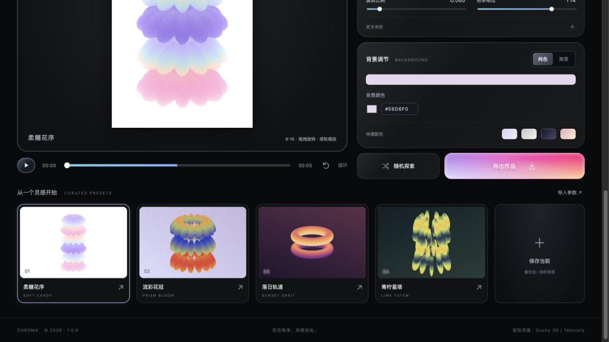

# CHROMA · 形色实验室

**自由调色塑形，生成动态艺术。**



CHROMA 是一个在浏览器中运行的参数化三维创作工具。选择花瓣、圆环或星形，调整数量、层次、色带和背景，实时观察形态变化，再导出图片或短视频。项目提供网页版与小红书小工具离线版，使用 Vite、Three.js 和原生 JavaScript 构建。



## 从四种风格开始

| 预设 | 形态与配色 |
| --- | --- |
| 柔糖花序 | 默认 12 片花瓣、6 层，柔和糖果色与雾紫背景 |
| 流彩花冠 | 15 片花瓣、3 层，浓郁流彩与紫色渐变背景 |
| 落日轨道 | 暖色双圆环与深紫背景 |
| 青柠星塔 | 8 片交错星形、5 层，青柠色带与深青背景 |

预设封面均由实际渲染器按对应参数生成。构建会核对图片清单与预设参数，避免参数改了、封面仍停留在旧版本。



## 可以调整什么

- **形态**：花瓣数量、层数、半径、纵向拉伸、横向压缩、局部旋转、层间距与扭转；滑杆和数字输入均可使用。
- **色彩**：教程、日落、糖果和酸性配色，色带比例、相位、色相、颗粒与三轴映射。
- **背景**：纯色或双色渐变，支持 HEX 色值、渐变方向、颜色交换与快捷配色；背景参与作品导出。
- **取景**：拖拽旋转、滚轮或双指缩放，工作台可输入 40%–400% 的视角缩放值。
- **动画**：5 秒时间轴、播放暂停、速度调整、逐时刻取景。
- **保存**：收藏当前参数、自动保存编辑进度，支持参数导入与备份。

新版首次启动使用柔糖默认；旧版缓存可通过“恢复旧版创作”主动找回，已有收藏继续保留。“恢复默认”同时重置参数、动画时刻、取景和预设选中状态。

## 本地运行

使用 Node.js 20.19+ 或 22.12+，并安装 npm。

```sh
npm install
npm run dev
```

打开终端显示的本地地址，默认是 `http://127.0.0.1:5173/`。

```sh
npm test           # 参数、存储、录制、相机与启动状态回归测试
npm run build      # 网页静态构建，输出 dist/
npm run preview    # 预览网页构建
```

## 图片与视频导出

| 能力 | 网页版 | 小红书小工具版 |
| --- | --- | --- |
| PNG 图片 | 1080 × 1920 或 2160 × 3840 | 540 × 960 或 720 × 1280；低档限制 540 |
| 动画视频 | 5/10 秒，720p 或 1080p，24 fps；根据浏览器提供 MP4 / WebM | 支持编码的设备上生成 5/10 秒 MP4，540p 或 720p；低档限制 540 |
| 保存位置 | 浏览器下载 | 图片保存相册；MP4 保存至小工具文件区，可回看 |
| 参数备份 | JSON 文件导入与导出 | 参数文本备份与粘贴导入 |

视频为无声实时录制，保留当前背景、视角、动画时刻与速度。录制期间需要保持页面可见；设备或浏览器缺少编码能力时会提示不可用。

小工具图片保存要求小红书 9.42+；MP4 文件保存依赖 9.49+ 文件系统与设备编码能力。三维初始化失败时使用明确标注的 Canvas 2D 简化预览，其画面与三维渲染有差异。

## 构建小红书离线包

构建脚本已包含本地资源校验与包体审计，需要本机安装 `python3` 与 `zip`，无需额外下载 skill。

```sh
npm run build:minitool
```

产物为 `artifacts/chroma-minitool.zip`，根入口位于 `dist-minitool/index.html`。所有运行资源包含在离线包中，脚本转换为经典 IIFE，另有 GPU 预算与运行时降级适配。

上传后应在创服平台模拟器、Android 和 iOS 真机上验证同一 ZIP。普通浏览器检查及静态审计不能替代实际容器验收。

## 目录

```text
src/                  网页与小工具入口、渲染器、参数、平台适配
src/assets/presets/   真实预设缩略图及对应参数清单
public/               标签页图标
scripts/              构建与资源校验
test/                回归测试
design/              预设图片导出页、设计及验证记录
docs/images/         项目展示配图
```

## 灵感与致谢

作品生成方式受到 [Ducky 3D / Teknosis 的视频教程](https://www.youtube.com/watch?v=o6UY27rjfX4) 启发，采用独立椭球实例沿圆周排列的方式在网页中实现，并加入可调背景、参数面板、预设与导出流程。

这是基于教程思路的网页实现。材质、精确配色及动画仍存在差异，尚未完成与原视频逐帧一致的视觉验收；相关记录见 [视频观察记录](design/video-notes.md)。
