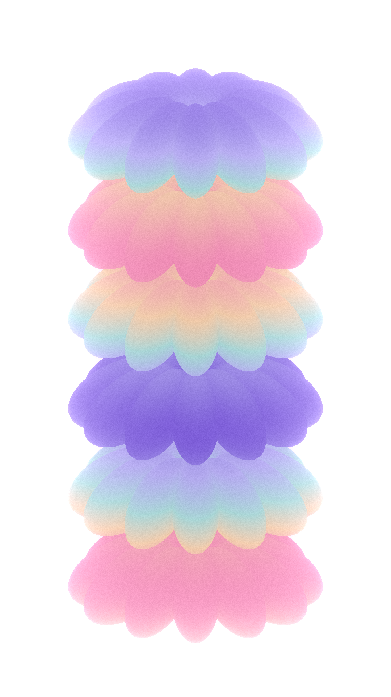

最近看三维设计教程时，我被一种效果吸引住了：一圈花瓣叠成几层，色彩沿着表面流动，转动以后，又像另一件作品。

我想把这个过程做成一个随手能玩的工具。打开页面，拖动几个滑杆，看到形态和颜色一起变化，喜欢就存下来。

于是做了 **CHROMA · 形色实验室**。

它的一句话介绍是：**自由调色塑形，生成动态艺术。**

## 先有一件作品，再慢慢改

打开工具，默认是一组柔糖花序：12 片花瓣，叠成 6 层，紫色、粉色和浅青色落在不同的位置。它可以静静停在那里，也可以随着时间转动。

从这里开始，可以先改一个参数。

花瓣数量增加，轮廓会变得更密；层间距拉开，几层之间的关系会更清楚；旋转角度一变，原本平展的花瓣又会立起来。参数旁边都保留了数字输入，遇到喜欢的组合，可以准确记下来。

我觉得这个过程有意思的地方，在于改动很小，结果却常常出乎意料。

## 四组预设，四种方向

我也放了四个起点，方便不想从零调的人直接试。

柔糖花序偏柔和，流彩花冠的颜色更浓；落日轨道换成暖色双圆环，放在深紫背景上；青柠星塔则用了交错的星形层次和更深的青色背景。

它们在形态、层数、配色和背景上都有区别。预设小图由工具按真实参数生成，点进去，看到的就是这组参数对应的作品。

## 背景和取景，也一起调整

做着做着，我发现同一个形体，换了背景，气质会差很多。

所以背景也放进了工作台。可以用纯色，也可以选两个颜色做渐变，输入色值、调整方向，再看它和主体放在一起的效果。

画面支持拖拽旋转、滚轮和双指缩放，也可以在面板里直接填写缩放比例。从远处看整体，拉近看色带，喜欢的视角会跟着图片一起导出。

界面采用深色底，搭配带有光感的渐变控件。预览和参数放在同一个工作区，边调边看，手机上则往下滚动操作。

## 让它动起来，再保存

点击“让它流动”，就能看到一段循环动画。也可以拖动时间轴，停在喜欢的一帧，导出竖版 PNG。

如果想留下变化的过程，工具也提供短视频导出。网页版会根据浏览器的编码能力提供 MP4 或 WebM；小红书小工具版在支持的设备上生成 MP4，保存在小工具文件区。录制时需要保持页面可见。

图片之外，我还保留了参数备份和预设收藏。一个组合调到一半，可以之后接着做；发现一个好看的变化，也能先留在自己的预设库里。

## 把源码也放出来

CHROMA 用 Vite、Three.js 和原生 JavaScript 实现，代码包含网页版，以及适配小红书容器的离线版本。

视觉生成的起点来自 Ducky 3D / Teknosis 的一支教程。我沿着独立椭球排列、堆叠和色带映射的思路，在网页里重新实现，再补上参数、背景、预设和保存流程。当前材质和动画与原教程仍有差异。

[GitHub 项目与运行说明](https://github.com/chansonkang/chroma-form-studio)

[原视频教程](https://www.youtube.com/watch?v=o6UY27rjfX4)

感兴趣的话，可以从任意一个预设开始，只改一个参数，看看下一件作品会长什么样。
